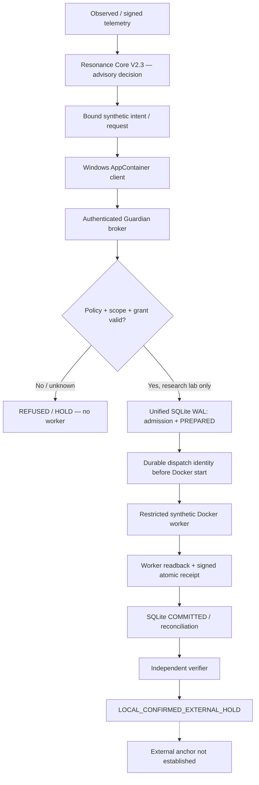

<div align="center">

# Trustless Guardian

**An experimental authorization, isolation, and independently verifiable execution boundary for AI-agent actions.**

**Authenticate → Authorize → Isolate → Record → Recompute**

[](https://github.com/pipavlo82/trustless-guardian/pull/13)
[](docs/RC3_REVIEW.md)
[](https://github.com/pipavlo82/trustless-guardian/pull/13)
[](LICENSE)

**Gates, not scores. · Don't trust. Recompute.**

[Overview](#overview) · [Architecture](#architecture) · [Resonance Core](#resonance-core-v23) · [Evidence](#evidence-and-validation) · [Getting started](#getting-started) · [Limitations](#security-boundaries-and-non-claims) · [Research PR #13](https://github.com/pipavlo82/trustless-guardian/pull/13)

</div>

---

## Project status

**Current candidate: Guardian RC3 + frozen Resonance Core V2.3.** This is a single **Draft research integration**, tracked in [PR #13](https://github.com/pipavlo82/trustless-guardian/pull/13). The code in that PR is **not merged into `main`**. A successful research demonstration or CI run does not mean production security approval.

| Area | Verified or demonstrated | Boundary |
| :--- | :--- | :--- |
| Source consolidation | The historical Guardian research chain and merged PR #10–12 successors are ancestors of the RC3 review branch | Merging ancestry does not automatically requalify old evidence |
| Resonance Core V2.3 | Frozen source SHA-256 and one-host controlled-fault research results | Not a production policy engine or natural-failure predictor |
| Authorization | A fresh Windows AppContainer session, authenticated broker, scoped grant, and refusal controls in a synthetic laboratory | Does not authorize arbitrary tools, wallets, or external effects |
| Execution | One authorized, constrained Docker worker and signed atomic receipt in a fresh RC3 local run | Synthetic hash worker only |
| Durable state | Candidate unified admission/execution SQLite WAL lifecycle, receipt readback, and local reconciliation | No physical power-loss or coherent all-file rollback guarantee |
| Independent recomputation | Separate code-only verifier corroborated the local synthetic result | Same-host evidence, not an externally trusted anchor |
| CI, 22 Nov 2026 | **13/13 GitHub checks passed** on the reviewed RC3 branch, plus separate local tests | Green CI is not a human security review |
| Release | **RESEARCH / DRAFT** | **PRODUCTION HOLD** |

The scientific detector and OS enforcement serve **different purposes**. No Resonance score, alarm, or recommendation grants execution permission. Guardian must independently authorize the exact operation.

## Overview

An agent can propose an action, a policy engine can authorize it, an operating system can restrict what is actually executed, and an observer can evaluate the resulting evidence. These are **four separate claims**.

Trustless Guardian investigates an enforceable boundary around those claims: **the proposing agent is not its own authority**. The research implementation binds a request to an independently issued scope, constrains a worker, records execution evidence, and checks that evidence through a separate verifier.

The current RC3 laboratory combines historical Guardian security research with a synthetic end-to-end execution pilot and the frozen Resonance Core V2.3 scientific source. It is not a hosted agent, general-purpose desktop assistant, or production security product.

## Architecture



**Important distinction:** the published fresh end-to-end demo uses a **synthetic preconstructed intent**. It proves the request-to-Guardian execution path under local laboratory assumptions; it **does not** prove that this demo itself sampled real telemetry and invoked Core V2.3 to produce that intent. Core V2.3 and its scientific evaluation are separately implemented and source-pinned.

### Authorization and containment

The studied boundaries include:

- Windows AppContainer client confinement and measured access-denial controls; the broker authenticates its IPC peer and signed messages.
- A bounded, request-bound Ed25519 execution grant, subject/role/tool/resource/service/destination binding, one-use consumption, and rejection of replay or substitution.
- A fixed, explicitly allowlisted synthetic hash operation in a constrained Docker container: no network, read-only filesystem, dropped capabilities, nonprivileged UID, resource bounds, and a fixed worker/image identity.
- Explicit **REFUSED**, **UNKNOWN/HOLD**, and **RECOVERY_REQUIRED** outcomes when proof or authorization is insufficient.

Earlier draft branches contain additional JWT, SIWE, MCP-scope, Linux, and token-security experiments. Those studies are preserved as historical research; their existence does **not** mean every authentication or isolation mechanism is simultaneously active in the RC3 Docker path.

### Execution lifecycle and recovery

The new research candidate uses one SQLite WAL transaction boundary for admission and the first execution state. Its five normal transitions are:

```text
PREPARED
  → DISPATCH_RECORDED
  → RESULT_OBSERVED
  → RECEIPT_PUBLISHED
  → COMMITTED
```

A dispatch identity is recorded before Docker start. The candidate retains the container for readback instead of deleting it before the evidence transaction. A signed receipt binds the grant, request, worker identity, and observed outcome; publication uses a temporary file, flushing, and atomic replacement where available.

The separate recovery/reconciliation checker **must not create or start a worker**. A missing or damaged receipt, a conflicting execution identity, or an uncertain result leads to a hold or recovery-required state. A complete published receipt with an earlier SQLite state can be reconciled through a constrained compare-and-swap after verification, without re-dispatching the operation.

Local physical process-crash windows and reconciliation experiments are documented separately. Their bounded results do **not** establish universal exactly-once execution, crash durability for every storage configuration, or safety against a simultaneous rollback of every local evidence file.

## Resonance Core V2.3

**Resonance Core is a deterministic experimental state-and-decision model, not a new LLM.** Its output is advisory. Guardian remains the independent execution authority.

The byte-identical frozen V2.3 source lives at [`research/resonance_core_v23/core_v2_3.py`](research/resonance_core_v23/core_v2_3.py) with SHA-256:

```text
10790b3fb770496e8213986a320b825fd90dbc9990c96df81fa809fdd5ff257f
```

The original V1 Core is retained in the [historical PR #7 source](https://github.com/pipavlo82/trustless-guardian/blob/2a40075a7f217e9c385cdfaf27c0267fa788d574/research/resonance_guardian_v1/reference_core/agent.py). V2, V2.1 and V2.2 are supplied as source baselines. V2.3 introduces a clear distinction between a **resource warning** and a **confirmed resource incident**, with two consecutive resource advisory samples required for confirmation; signed causal IPC failure signals remain separately evaluated.

The model distinguishes `OBSERVE`, `INVESTIGATE_CHANGE`, `DEFER`, and `UNKNOWN/HOLD` as appropriate to state and trustworthiness. Missing or untrusted telemetry must not silently become a safe authorization signal.

### Controlled Windows evidence

In the local, scripted Windows experiments, V2.3 matched V2.2's **48/48 detected injected faults** and reduced *false incident-classified ticks* from **102 to 67** in one preregistered stress study. The resulting trade-off included a roughly **110 ms** additional delay on resource-only failures. These numbers are bound to the stated one-host workload and controlled injection population.

The experiments are **not** evidence of predictive performance on natural failures, a second machine, or general statistical superiority for every workload. The original Core and prior models remain separate baselines. Details and provenance: [Core V2.3 notes](research/resonance_core_v23/README.md).

## Evidence and validation

Evidence must be independently recomputable under an identified source version. A self-issued signature alone is not proof that an external action happened.

**Research RC3 checkout, 22 November 2026:**

| Check | Observed result |
| :--- | :--- |
| GitHub Actions | 13/13 checks green on PR #13 at the recorded RC3 candidate |
| Python unit discovery | 202/202 normal, 202/202 optimized (`-O`) in local Windows replay |
| Source integrity | RC3 source inventory: 712 pinned files; baseline check PASS |
| RC3 physical source mutations | 9/9 detected with valid restored controls |
| Historical integrity | V1 and V8 passed on their exact frozen commits; V1 11/11 and V8 7/7 mutation controls |
| Fresh synthetic end-to-end | One authorized Docker start, signed receipt and `COMMITTED` |
| Four refusal controls | Replay, substituted request, absent grant, and revoked policy: no additional worker starts |
| Independent readback | `LOCAL_CONFIRMED_EXTERNAL_HOLD` — explicitly **not** external-anchor proof |

Some earlier trials include Windows `TerminateProcess` injections, SQLite reconciliation and independent Docker inspection. Those trials were run in local candidate workspaces. **They must not be described as a fresh full crash-matrix replay of this final GitHub composite branch.**

Technical review and explicit limits: [`docs/RC3_REVIEW.md`](docs/RC3_REVIEW.md). Security assumptions: [`docs/SECURITY_BOUNDARIES.md`](docs/SECURITY_BOUNDARIES.md).

## Getting started

### Review the research branch

```bash
git clone https://github.com/pipavlo82/trustless-guardian.git
cd trustless-guardian
git fetch origin review/guardian-resonance-rc3-20261122
git switch -c guardian-rc3-review --track origin/review/guardian-resonance-rc3-20261122
```

Use the exact tested commit when independently comparing evidence. On the default `main` branch the RC3 code is **not yet merged**.

### Portable unit tests

Use Python 3.12. The broader native laboratory needs pinned runtime dependencies, including `cryptography` and `PyNaCl`; follow the versioned project setup rather than upgrading dependencies during a security replay.

```bash
python -B -m unittest discover -s tests -q
python -B -O -m unittest discover -s tests -q
python -B -m research.resonance_core_v23.SMOKE_REPLAY
```

Windows-only tests requiring OS handles/NTFS primitives are intentionally not claimed as portable Linux functionality.

### Windows / Docker synthetic demonstration

Prerequisites: Windows with supported AppContainer facilities, the pinned Python test runtime, a Docker Linux Engine with the expected local synthetic image and worker binary, and suitable OS privileges. **A clean checkout alone does not provision those requirements.**

```powershell
python -B research/scoped_execution_lab_v3/guardian_rc2_adapter.py --out "C:\\lab-evidence-unique-01" --intent research/scoped_execution_lab_v3/examples/intent-synthetic.json

python -B research/scoped_execution_lab_v3/verify_unified_independent.py "C:\\lab-evidence-unique-01"
```

Use a **new** writable output folder for each run; the tool intentionally refuses to overwrite prior run results. The example intent is explicitly synthetic and does not claim independent telemetry provenance. Keep generated runtime folders **out of Git**: they may contain temporary signing material, process identifiers, SIDs, and unfiltered local security evidence.

Only the fixed synthetic action is permitted; there is no unrestricted command-execution API or bypass around Guardian authorization.

### Repository layout

| Path | Purpose |
| :--- | :--- |
| [`guardian/`](guardian/) | Foundational enforcement implementation and Windows primitives |
| [`research/guardian_mutual_ipc_v1/`](research/guardian_mutual_ipc_v1/) | Prior authenticated broker and signed IPC research |
| [`research/scoped_execution_lab_v1/`](research/scoped_execution_lab_v1/) | Historical pinned synthetic execution lab |
| [`research/scoped_execution_lab_v3/`](research/scoped_execution_lab_v3/) | Current additive unified WAL + atomic receipt research candidate |
| [`research/resonance_core_v23/`](research/resonance_core_v23/) | Frozen deterministic Core V2.3 and portable supporting sources |
| [`tools/integrity_rc3.py`](tools/integrity_rc3.py) | Explicitly pinned RC3 source integrity and physical mutation checks |
| [`integrity/`](integrity/) | Historical integrity profiles, manifests and RC3 transition |
| [`tests/`](tests/) | Versioned tests and additive RC3 source-pin/regression controls |
| [`docs/RC3_REVIEW.md`](docs/RC3_REVIEW.md) | Dated technical review, replay scope and nonclaims |

## Research history and pull requests

Research history is intentionally preserved, not deleted or squashed.

| PR | Status | Significance |
| :--- | :--- | :--- |
| [#1–8](https://github.com/pipavlo82/trustless-guardian/pulls?q=is%3Apr+is%3Aclosed) | Closed as superseded, **not merged into main** | Previous stacked Guardian, authentication, IPC, and Original Core work retained in commit history |
| [#9](https://github.com/pipavlo82/trustless-guardian/pull/9) | Merged into `main` | Repository homepage/docs update |
| [#10](https://github.com/pipavlo82/trustless-guardian/pull/10) | Merged into research branch | Windows availability CI transition |
| [#11](https://github.com/pipavlo82/trustless-guardian/pull/11) | Merged into research branch | Ordinary-exception CI transition |
| [#12](https://github.com/pipavlo82/trustless-guardian/pull/12) | Merged into research branch | Native reliability CI transition |
| **[#13](https://github.com/pipavlo82/trustless-guardian/pull/13)** | **Current open Draft** | **Single consolidated Guardian RC3 + Core V2.3 technical review** |

Old source-specific integrity claims remain tied to their original commits. RC3 adds a separately pinned inventory; it does **not** silently rewrite the V1 or V8 historical trust bases. Merging RC3 into `main` is a distinct decision.

## Security boundaries and non-claims

Guardian RC3 does **not** currently establish:

- Production trust-root distribution, organizational signer authority, production key custody, or comprehensive key revocation.
- An independently controlled, durable **external anchor** that catches coherent rollback of SQLite, WAL, receipt, and all local journals.
- Full power-loss durability, arbitrary external protected-effect correctness, or universal exactly-once execution.
- General Windows/Linux confinement beyond the specific tested pilots, or production-grade unrestricted agent/tool isolation.
- Independent second-host validation and human security approval.
- Autonomous continuously operating AI, human-intent reading, physical resonance, consciousness claims, or natural-fault prediction.

When evidence is incomplete, outcomes must remain `UNKNOWN/HOLD`, `RECOVERY_REQUIRED`, `NOT_ESTABLISHED`, or `REFUTED` as appropriate. Historical negative controls, failed attempts, and known gaps are research evidence; they are not to be reclassified as successes.

**Release decision: RESEARCH / DRAFT. PRODUCTION HOLD.**

## Principles and license

- **Gates, not scores.** A model proposal is never a grant.
- **Don't trust. Recompute.** Bind claims to source, evidence and an independent check.
- **A failed control is a result.** Preserve refutations, missing coverage and provenance.
- **No hidden fallback.** A failed Guardian gate must not silently route execution through an alternative path.

The repository is distributed under [Apache-2.0](LICENSE); third-party components retain their applicable notices and licenses. Source publication is not a transfer of project control or proof of production certification.

---

<div align="center">

**A bounded, reproducible AI-agent execution security research project.**

[Read the RC3 technical report](docs/RC3_REVIEW.md) · [Inspect PR #13](https://github.com/pipavlo82/trustless-guardian/pull/13) · [Security boundaries](docs/SECURITY_BOUNDARIES.md)

</div>
