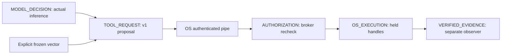

# guardian.agent-tool.v1

**Experimental proposal adapter; not an authorization credential.**
Executable schema: `demo/developer-preview/agent_tool_v1.py`. Canonical JSON is
UTF-8, sorted keys, compact separators, ensure_ascii=true, allow_nan=false.
Duplicate keys, unknown fields and oversized input are refused.

The model-facing tool accepts exactly `{resource, content}`. The provisioner
selects context; the adapter forms this exact object. A malicious adapter can
still propose anything: the unchanged broker independently authenticates and
checks it through `guardian.ipc.v02` / `guardian.action.v0`.

| Required field | Contract |
| --- | --- |
| schema | guardian.agent-tool.v1 |
| actor | Provisioned SID; broker compares actual pipe token |
| action | replace_utf8 |
| resource | Declared identifier synthetic-source or protected-config; never a path |
| scope / policy_version | Exact independently selected policy values |
| policy_sha256 | Recomputed from exact canonical policy preimage |
| expires_at | Integer, now < expiry <= now + 45 seconds; broker rechecks |
| nonce | Exact invocation context value; broker durably consumes it |
| content | UTF-8 string, at most 128 bytes |
| evidence | Exactly before_sha256, 64 lowercase hex characters |

Maximum request: 16,384 bytes. `authorized`, raw paths, commands, provider endpoints,
server PIDs and caller-selected policies are not tool fields. The independently
provisioned named-pipe namespace and retained server PID handle bind the endpoint.
Authentication checks exact AppContainer SID, base user, low integrity, zero
capabilities, non-elevation and identification-level token. It confers no permission.
Lab connection timeout: 110 seconds; I/O: 8 seconds; agent: 120 seconds with cancellation.
Inherited stdio frames, including provider and tool results, are capped at 131,072
bytes. A bound violation fails the run; no truncated result is accepted as success.

The response contains schema, stage=TOOL_RESULT, status, authorization, execution,
retry=PROHIBITED, native and evidence_refs. Native tri-state and ambiguity remain;
request/native-response SHA-256 references are independently recomputable. A hash
is not proof of execution. Transport failure produces no successful tool result.
RECOVERY_REQUIRED remains ambiguous even if resource bytes equal earlier bytes.

Live and frozen-vector paths are separate populations. The adversarial direct-probe
tool is outside the action API and has no broker authority. It only attempts the
provisioner's synthetic path under the restricted token. Independent byte and
scratch observations are mandatory. The v1 adapter reuses v06 launch/relay and v04
fault fixtures, without changing core policy. Arbitrary clients/policies require
a separately reviewed adapter and verification contract.
