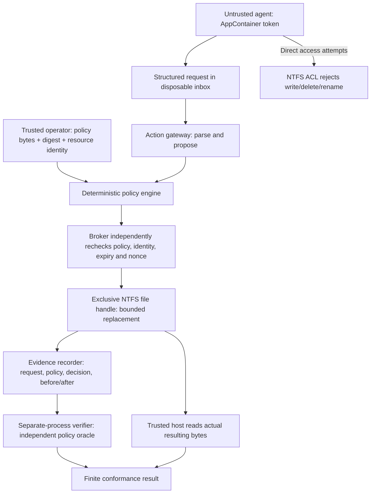

# v02 architecture

The current experimental path is `guardian.hardened.HardenedBroker` behind
`guardian.ipc` and `guardian.protocol`. A trusted laboratory provisioner launches
the agent and broker as distinct AppContainer principals with separate ACL grants.
The broker authenticates a pipe client, independently re-evaluates the unchanged
finite v0 policy, pins held parent/file identities, records intent, writes/readbacks
the resource, and commits a receipt. A separate process verifies that receipt;
the host independently inspects the actual resource.

See [IPC and trust-boundary diagram](IPC_SECURITY.md) and
[recovery state protocol](CRASH_RECOVERY.md). `tools/v02_lab.py` is the provisioning
and process witness; `tools/v02_worker.py` is the disposable child entry point.
Trusted test fault hooks are not fields in the IPC request. No production daemon
or general-purpose filesystem interface is provided.

The architecture below is preserved as the **historical v0** design. Its host-user
broker and mailbox transport are still regression-tested and are not represented
as the v02 authenticated path.

# Architecture: guardian.local-file.v0

## Component contracts

`guardian/gateway.py` admits bounded strict JSON (duplicate keys and nonfinite
numbers rejected). The only request fields are schema, actor, action, resource,
scope, policy_version, expires_at, nonce, content and evidence. Additional fields,
including `authorized`, are refused. The gateway's proposed decision is advisory.

`guardian/policy.py` evaluates an independently supplied `guardian.policy.v0`
policy. The pilot permits only `replace_utf8`, a symbolic resource named `sample`,
an exact actor and scope, a matching version, bounded content with an approved
prefix, a bounded expiry and a fresh nonce. Evidence binds the exact prior file
SHA-256. This evidence is a local precondition, not proof of AI inference or
judgment truth. Missing evidence yields UNVERIFIABLE + DENY; a contradicted
obligation yields REFUTED + DENY. Only an exact match yields VERIFIED + ALLOW.

`guardian/broker.py` ignores presented caller/gateway verdicts. It resolves a
fixed trusted resource path, opens the resource and policy exclusively, refuses
reparse files and multiple hard links, checks volume/file identity, recomputes
the policy digest and reruns authorization. The nonce ledger is SQLite inside
the protected directory. A nonce is committed before a write; this provides
fail-closed consumption in the exercised cases, not an atomic write/log transaction.

The production entry point is **not implemented**. In the lab, a trusted launcher
creates the child suspended, reads its OS token, verifies its AppContainer SID
and non-elevated state, attaches a single-process job, and resumes it. After exit,
the host reads the request from that child's inbox. Actor context and the test
clock are supplied by this trusted launcher, never taken from request metadata.
The Python broker API is a trusted-host API, not an authenticated network API.

`guardian/evidence.py` records exact request and policy digests, decision, scoped
authorization, principal, resource identity, nonce context, broker result,
before/after bytes and digests, and verification metadata. Records use
`guardian.evidence.v0`; their hash commits to `previous` and `body`. Individual
pilot records start at a zero predecessor. No durable signed ledger is claimed.

`guardian/verifier.py` runs as another process and does not import the policy
engine or broker. It recomputes the decision, exact authorization scope, record
hashes and allowed byte transition against an externally selected policy hash
and record head. It checks recorded consistency; independent host reads in
`tools/lab.py` establish the local execution observation. A record alone cannot
attest the host, OS token, physical prevention or external execution.

## OS identity and canonical bytes

The agent retains the user's TokenUser SID but receives a distinct AppContainer
package SID, low integrity and zero capabilities. Windows applies the restricted
AppContainer access context. This is a distinct restricted security principal,
not a newly created local account. No passwords or account creation are used.

The broker runs as the trusted non-elevated interactive user. Its API is narrowly
scoped, but its OS token is **not** reduced to a dedicated service identity.
The trusted host and other unconfined processes under that user are outside the
malicious-agent boundary.

Guardian canonical JSON is ASCII-escaped JSON, sorted keys, compact separators,
no NaN/Infinity. It is named only as Guardian's own profile. It is not asserted
to equal ReceiptOS, RVR or RFC 8785 canonicalization. External bytes remain exact.
