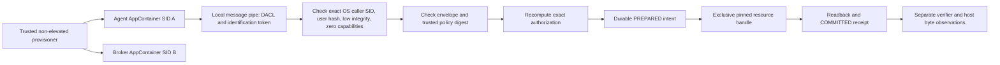

# guardian.ipc.v02

This is a bounded local Windows laboratory protocol. It is not a public service,
remote authorization API, or production agent-framework integration.



## Trust and provisioning

The trusted host creates two per-user AppContainers with different package SIDs,
no capabilities, low integrity, no inherited handles, and one process per job.
The same base TokenUser remains underneath both. This is OS-principal separation,
not separate Windows accounts, separate humans, or independence from the host.
The broker's token is checked before resuming it and again inside the broker.

An additional witness gives the parent a real inheritable resource-write handle,
proves that handle can write, then launches the agent with inheritance disabled.
The agent's WriteFile attempt records INVALID_HANDLE and the host independently
reads unchanged bytes. Native STATUS_INVALID_HANDLE exceptions are caught and
recorded explicitly; an unhandled child crash would fail this control.

Only the broker SID receives read/write access to the sample resource and full
access to its journal directory. It gets read/execute access to its runtime and
read access to policy. It receives no DELETE or WRITE_DAC grant on the resource,
no policy-write grant, and no grant on the outside-scope canary. The agent can
write only its laboratory scratch area. The host and SYSTEM remain trusted.
Windows' implicit AppContainer facilities/storage also remain; this is not proof
that every possible OS resource is unreachable. No passwords are used.

The server creates `\\.\pipe\LOCAL\Guardian-<random>` inside its namespace.
On the measured Windows build, another AppContainer reaches it through the exact
session/package path selected by the trusted host. That cross-namespace spelling
is an experimentally exercised compatibility detail, not a universal API promise.
An initial same-LOCAL-name attempt failed and is preserved as a development result.

## Authentication

The pipe is local-only, message-mode, one instance, with FIRST_PIPE_INSTANCE.
Its DACL grants the intended client a specific read/write mask **excluding**
FILE_CREATE_PIPE_INSTANCE. An unauthorized AppContainer is rejected by the OS.
After reading a message, the server calls ImpersonateNamedPipeClient with the
client's identification-only SQOS context, queries OpenThreadToken, then reverts
before accessing any resource. It checks the exact AppContainer SID, base-user
hash, low integrity, non-elevation and zero capabilities. Failed authentication
never dispatches an action. Revert failure terminates the serving process.

The client checks GetNamedPipeServerProcessId against a host-authenticated live
broker PID. The host keeps the inspected process handle alive for the session.
The request does not choose that PID, policy pin, filesystem path or caller token.
No SeImpersonatePrivilege is enabled: identification-level inspection is enough
in the exercised context. Authentication and policy authorization remain separate.

## Envelope

```json
{"schema":"guardian.ipc.v02","policy_sha256":"<trusted canonical policy SHA-256>","request":{"schema":"guardian.action.v0"}}
```

The nested request has the exact full v0 action fields documented in ARCHITECTURE.
The abbreviated example above is not an executable valid action. Envelope keys,
version and policy digest must match. The limit is 16,384 bytes. Duplicate keys,
nonfinite numbers, malformed structures and extra authorization flags are refused.
The parser uses Python's JSON byte-decoding domain; no RFC 8785 equivalence is
claimed. Guardian's own canonical policy/request digest rules remain explicit.

Symbolic action/resource/scope, actor, version, expiry, nonce, content and prior
resource digest are rechecked against independently provisioned policy. An
authenticated receipt or caller-supplied verdict is not action authority.

## Liveness and cancellation

Overlapped connect/read/write operations have bounded waits. CancelIoEx is followed
by draining completion before freeing the OVERLAPPED/buffer. The outer process job
also has a laboratory watchdog. An idle client is exercised. There is no general
availability guarantee under flooding, kernel hangs, or compromised broker code.
Client disconnect/timeout does **not** roll back a write already committed. The
durable nonce and receipt prevent automatic replay after a lost response. There
is no production cancellation or status-query API in this pilot.

Sources: [identification and impersonation semantics](https://learn.microsoft.com/en-us/windows/win32/api/namedpipeapi/nf-namedpipeapi-impersonatenamedpipeclient),
[I/O cancellation lifetime](https://learn.microsoft.com/en-us/windows/win32/api/ioapiset/nf-ioapiset-cancelioex),
[AppContainer isolation](https://learn.microsoft.com/en-us/windows/win32/secauthz/appcontainer-isolation).
