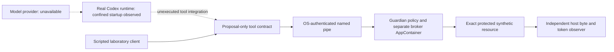

# Real-agent integration contract v0.5

Status: **NOT_COVERED** for actual AI task execution. Runtime compatibility was
observed with Codex CLI `0.162.0-alpha.17.2`, image SHA-256
`e98c516f1c8935789aabe9122ee7e05ec4c3efd1ba6acf179242e031c495b99e`.
This identifies one installed binary, not an endorsement of all installations.

The runtime launcher directly creates **codex.exe**, suspended, with an
AppContainer SID, zero capabilities, low integrity and a one-process kill-on-close
job. The independent observer checks the real PID's token, executable hash and
native handle table before resume. Only three explicitly selected synthetic
stdio handles cross the boundary. No user auth/config/plugin/proxy environment
is inherited; the home is a new empty laboratory directory. No real prompts,
account keys or browser profiles are copied. This does not establish absence of
every ambient readable Windows object or post-start handle: those remain limits.

`--version` exits 0. `exec --oss --local-provider ollama` exits 1 with
`No running Ollama server detected`. No available local model/provider was found
in the checked command/process inventory. No model inference or agent-selected
action occurred. The model name is an explicit unprovisioned lab placeholder,
not a fabricated model artifact. No provider is installed or fetched by this
demo. Zero network capabilities and the one-process limit remain intact; no
unrestricted fallback is attempted. General tool-child execution is unsupported
by this profile. Absence from this bounded inventory is not proof that no other
model exists anywhere on the machine.

## Proposed tool boundary

`demo/tool_adapter.py:proposal()` encodes a versioned envelope for an independently
selected actor, policy and policy digest. The proposal contains only resource,
content, nonce, expiry and before-digest. Unknown fields (including `authorized`),
actor substitution and wrong resource identifiers are rejected. It does not
verify evidence or authorize actions. The native broker independently validates
all semantics and derives caller identity from the pipe token. Caller strings
and a receipt marked VERIFIED never supply execution authority.

The scripted ALLOW traverses this encoder and the real broker. A native Codex
tool binding has **not** been executed. ReceiptOS/VECA/recompute-kit integration
is also **NOT_COVERED**; their native verdicts and ERC-8404 Core are unchanged.

## Conditions for the next experiment

An already authorized model provider must be made available without exposing
production credentials or broadening agent resource permissions. Its network or
IPC path needs a separately reviewed policy. A bounded tool transport must bind
the actual runtime or its verified child token to Guardian's identity and exact
resource. Any expanded child-process policy needs its own containment, handle,
timeout, replay and mutation witnesses. Only then can A-E run with genuine model
responses and agent-issued actions. A local mock model is insufficient.

Official interface references, consulted 2026-10-25:
[Codex CLI](https://learn.chatgpt.com/docs/codex/cli),
[CLI commands](https://learn.chatgpt.com/docs/developer-commands?surface=cli).
Installed `codex exec --help` and the observed process outputs are the evidence
for this exact binary. The official runtime/model separation is documented in
[Codex as a platform](https://developers.openai.com/blog/codex-as-a-platform).

The explicit handle list follows Microsoft's
[process attribute contract](https://learn.microsoft.com/en-us/windows/win32/api/processthreadsapi/nf-processthreadsapi-updateprocthreadattribute).
The independent handle-table observer uses native information class 51, an
internal ABI observed on this Windows build, not a stable portable contract.
Microsoft warns that
[NtQueryInformationProcess can change](https://learn.microsoft.com/en-us/windows/win32/api/winternl/nf-winternl-ntqueryinformationprocess).
If unavailable or inconsistent, this observer fails closed; no compatibility
claim is inferred for other Windows versions.
