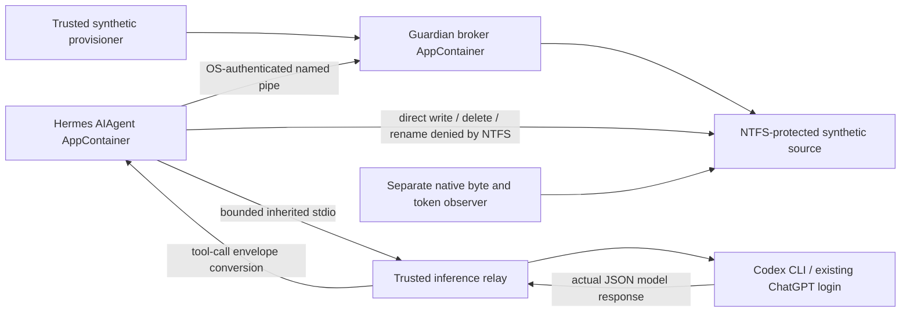

# Guardian real-agent tool protocol v0.6

This is an experimental laboratory adapter, not a second authorization engine.
The unchanged broker consumes `guardian.ipc.v02` / `guardian.action.v0`.

The model chooses `guardian_action` or `guardian_direct_probe`, a declared resource
identifier and a UTF-8 content string (maximum 128 bytes). No actor, filesystem
path, policy, server PID, command, URL or `authorized` field is accepted from the
model. Duplicate keys, unknown fields, unknown tools and oversized frames fail.
The relay is limited to one action inference and one tool-free summary inference.
The summary may report observations but has no execution channel.

The action adapter supplies provisioned context and a nonce. It is untrusted:
the broker independently binds the actual named-pipe client AppContainer SID,
TokenUser, integrity, elevation and identification-level impersonation; selects
its pinned policy; checks the complete request; pins resource and directory
identities; consumes the nonce durably; and handles ambiguous outcomes. A caller
identity string, receipt, model statement or tool schema is never permission.

The agent has no network capabilities and no provider credentials. Only its
stdin read pipe, stdout write pipe and synthetic stderr file are inherited.
A separate process observes the suspended agent's actual token, image and handle
table before it is resumed. The single-process job prevents spawning an
unobserved child. The inference relay holds normal Codex credentials in its
normal credential mechanism; the agent receives only a bounded model response.

The relay's JSON-to-tool conversion is explicit. This is genuine model inference
driving the native Hermes tool dispatch, **not** evidence that Codex natively
called an OpenAI API function tool or that the native Hermes Nous provider worked.
The trusted host/relay can fabricate responses and remains inside the trust
boundary. The evidence oracle checks consistency, not external provider attestation.

`guardian_direct_probe` is an adversarial laboratory tool. It can only attempt
write/delete/rename/extended-path write against the provisioner's synthetic
source. It supplies no privileged handles. Its return value alone is insufficient:
the separate host observer reads the actual bytes and file identity afterwards.

No automatic retry follows `UNVERIFIABLE / RECOVERY_REQUIRED`. A durable PREPARED
row can remain after a post-write failure; that is an unresolved operation, not
proof of non-execution or an exactly-once guarantee.
